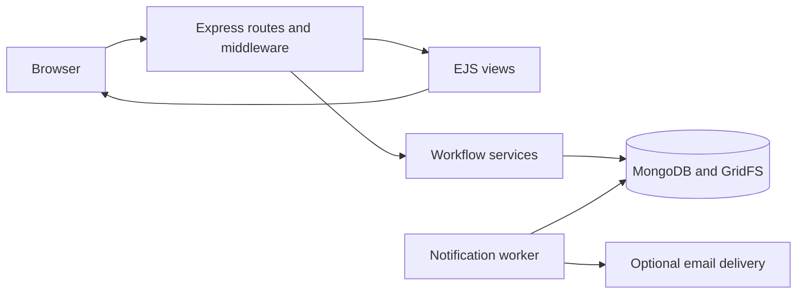

# CareCycle

CareCycle is a medical equipment donation prototype that connects donors with verified non-governmental organizations (NGOs), from equipment listings and quantity requests to collection, handover acknowledgement, and receipts.

## Overview

Useful equipment can remain unused while organizations struggle to find suitable donations. CareCycle gives donors a place to describe available equipment and gives approved NGOs a way to request it and coordinate collection. Administrators review organizations and oversee participant activity.

The project brings availability, request decisions, pickup arrangements, and donation history into one workflow. It is an alpha prototype; organization verification does not certify equipment condition or medical suitability.

## Demo and preview

[Open the CareCycle demo](https://carecycle-demo.onrender.com/demo)

The public demo offers donor and NGO roles using clearly labelled fictional accounts and equipment. Registration, uploads, administrative access, and outbound email are disabled. Activity limits and maintenance may temporarily restrict interaction; do not submit real donation or personal information.


The screenshot shows the homepage in a donor session; navigation varies by role.

## Features

### Donors

- Create listings with equipment category, condition, quantity, location, practical equipment details, and optional images.
- Edit listings, adjust quantities within allocation rules, and withdraw available equipment.
- Accept or reject NGO requests and track available, allocated, and handed-over quantities.
- Access organization contact details after request acceptance.
- Coordinate pickup, record handover quantities, and view donation history and receipts.

### NGO members

- Submit an organization profile and verification document for administrative review.
- Browse approved equipment listings with category, condition, and location filters and pagination.
- Request quantities with a need statement and track decisions and collection progress.
- Cancel pending requests and participate in cancellation and missed-pickup workflows after acceptance.
- Confirm pickup arrangements, acknowledge handover, and add aggregate outcome notes to receipts.

### Administration and accounts

- Review organization evidence, approve or reject applications, and moderate participant accounts and listings.
- Review workflow exceptions, activity history, and receipts; access operational diagnostics.
- Register donor or NGO accounts, verify email addresses, and request password resets when mail delivery is configured.
- Receive in-app lifecycle notifications and manage optional notification email preferences.

## Technology stack

| Purpose | Technologies |
| --- | --- |
| Application | JavaScript ES modules, Node.js 22, Express 4 |
| Interface | Server-rendered EJS, HTML, CSS, browser JavaScript |
| Persistence | MongoDB, Mongoose, GridFS for private uploads |
| Authentication and request handling | bcrypt, JSON Web Tokens, MongoDB-backed sessions, cookie-parser, Multer |
| Email | Nodemailer |
| Verification | Node.js test runner, isolated MongoDB test instances, Playwright, axe-core |
| Build and hosting support | npm lockfile, GitHub Actions, Dockerfile, Render startup script |

## Architecture and workflow



`index.js` starts the server after database checks. Routes apply authentication, role checks, and validation before controllers call workflow services. MongoDB transactions coordinate allocation and lifecycle changes, while the server also runs a notification worker.

1. A donor verifies their email and creates an equipment listing.
2. An NGO submits an organization profile; an administrator reviews its evidence.
3. An approved NGO with verified email requests an available quantity.
4. The donor accepts or rejects the request. Acceptance allocates stock and enables contact sharing.
5. Both parties coordinate collection and acknowledge handover before issuing a receipt.

Implemented safeguards include ownership checks, CSRF protection for form actions, rate limiting, password hashing, persisted sessions, and controlled access to uploaded media. These mechanisms do not constitute a security audit or a production-readiness guarantee.

## Project structure

```text
index.js                 Application entry point
src/
  app.js                 Express application assembly
  server.js              Database startup and worker lifecycle
  config/                Runtime and database validation
  routes/                HTTP routes and access gates
  controllers/           Request handling and view rendering
  services/              Donation workflows and supporting services
  models/                MongoDB schemas
  middleware/            Authentication, authorization, and request safeguards
  validators/            Input validation
views/                   EJS pages and shared partials
public/                  Styles, browser scripts, and public images
scripts/                 Checks and administrative utilities
tests/                   Unit, integration, and browser suites
.github/workflows/       Continuous integration
Dockerfile               Production container build
```

## Local setup

### Prerequisites

- Node.js **22.14.0 or later within the 22.x series** and npm **10.x**, as required by `package.json`.
- A dedicated development MongoDB database on an initialized replica set with transaction support. A standalone database is insufficient for the donation workflow.
- A configured mail service for email verification, password recovery, contact delivery, and optional email notifications. In-app notifications do not require email delivery.

### Installation and configuration

```sh
git clone https://github.com/kunalpehere/CareCycle.git
cd CareCycle
npm ci
```

Configure the required services locally and keep private configuration outside version control. The runtime requires database connectivity and authentication/session configuration; mail settings must be complete if enabled. Configuration handling is defined in `src/config/runtime.js`. Development can load ignored local configuration, while production expects settings supplied by its environment.

Use a fresh development database for initial setup. Development startup initializes application models and supporting stores and checks request indexes. Existing databases with incompatible indexes require the repository's migration utilities to be reviewed separately; production expects request indexes to be prepared before startup. Do not run migrations against shared data merely to try the application.

The repository includes `db:replica:prepare` and `db:replica:init` helpers for a dedicated local development replica set. Preparation creates a fresh data directory; initialization requires a separately running MongoDB instance that matches the helper's development configuration. These helpers are not a production provisioning procedure.

After configuring the services, validate settings and start the application:

```sh
npm run config:check
npm run dev
```

Open `http://localhost:4000` when using the default port. `config:check` validates configuration without connecting to the database; successful validation alone does not establish service readiness. Use `npm start` to run without automatic file watching.

### Trying the workflow

Register separate donor and NGO accounts and complete email verification. The NGO must submit a profile and receive administrative approval before browsing and requesting equipment. Administrator access is provisioned separately through the administrative tooling; public registration does not grant that role.

Create a listing as the donor, request a quantity as the approved NGO, then return to the donor workspace to review it. Continue through pickup confirmation, handover acknowledgement, and receipt issuance. Use fictional data in development.

## Selected HTTP routes

Most routes serve HTML pages or process browser forms rather than exposing a standalone REST API. Protected routes require an authenticated session and the relevant role; request-specific pages also enforce participant access.

| Method | Route | Purpose and access |
| --- | --- | --- |
| GET | `/` | Public homepage |
| GET | `/demo` | Fictional role chooser, only when demo mode is enabled |
| GET | `/donor/dashboard` | Donor workspace |
| GET | `/ngo/equipment` | Equipment discovery for an approved NGO |
| GET | `/ngo/requests` | Approved NGO's request history |
| GET | `/donor/requests` | Requests for the signed-in donor's listings |
| GET | `/donor/requests/:requestId/pickup` | Donor participant's collection arrangements |
| GET | `/ngo/requests/:requestId/receipt` | Approved NGO participant's receipt view |
| GET | `/notifications` | Notifications for the signed-in account |
| GET | `/admin/diagnostics` | Administrator-only operational view |
| GET | `/health/live` | Public JSON liveness response |
| GET | `/health/ready` | Public JSON readiness response; HTTP 503 when dependencies are unavailable |

Listing creation and equipment requests additionally require verified email. State-changing forms require CSRF validation. Use the interface to submit actions with the required form fields and access checks.

## Checks and tests

Install dependencies before running these commands:

| Command | Scope |
| --- | --- |
| `npm run check` | JavaScript syntax checks across application, scripts, and tests |
| `npm test` | Syntax checks followed by the unit suite |
| `npm run test:integration` | Isolated database workflow and persistence regressions |
| `npm run test:browser` | Chromium workflows at desktop and mobile viewport sizes, including accessibility checks |
| `npm run test:demo-browser` | Dedicated fictional-demo browser checks |

The test runners supply isolated configuration rather than using development service settings. Integration and browser suites create disposable MongoDB instances and may download a MongoDB binary. Browser suites also require Playwright's Chromium installation. Test diagnostics are written to ignored artifact directories.

GitHub Actions defines unit checks on Linux and Windows and integration/browser checks on Linux. Workflow configuration describes the intended checks, not their current pass status.

## Limitations and proposed improvements

- Supported listing categories are currently wheelchairs, walkers, canes, and stethoscopes.
- Equipment descriptions and organization approval do not replace inspection, cleaning, clinical assessment, or medical advice.
- Receipts are versioned HTML handover records, not equipment certification or tax documentation.
- Email verification and recovery depend on a working mail service; disabling email limits account workflows.
- Production operation requires separately managed database topology, deployment configuration, private media, and recovery procedures. The Dockerfile and Render startup script do not by themselves establish a working deployment.
- **Proposed improvements:** expand equipment categories with suitable validation, add broader browser coverage, and assess workflows with intended users. These are future work, not completed features.

## Contributing and licensing

Keep changes focused, use fictional test data, and run checks appropriate to the affected workflow before opening a pull request. Never commit private configuration or uploaded participant records.

`package.json` declares ISC, but the repository does not contain a standalone license file. Confirm licensing terms before reuse or redistribution.
