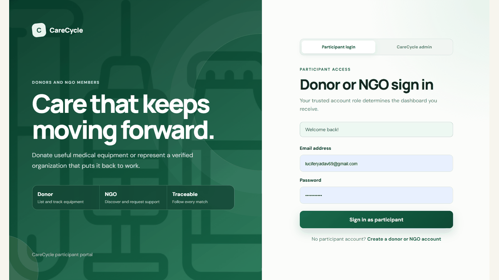
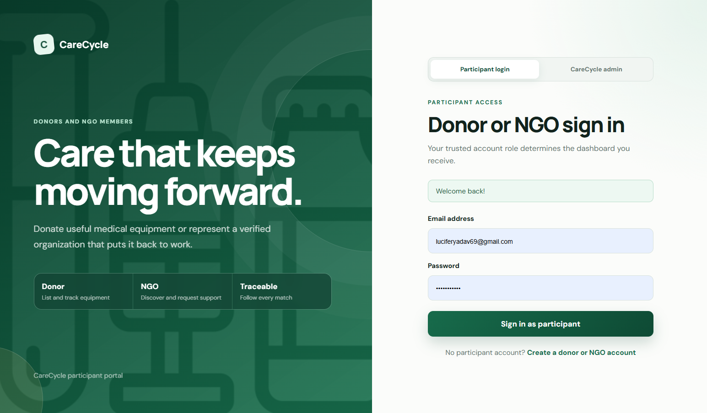
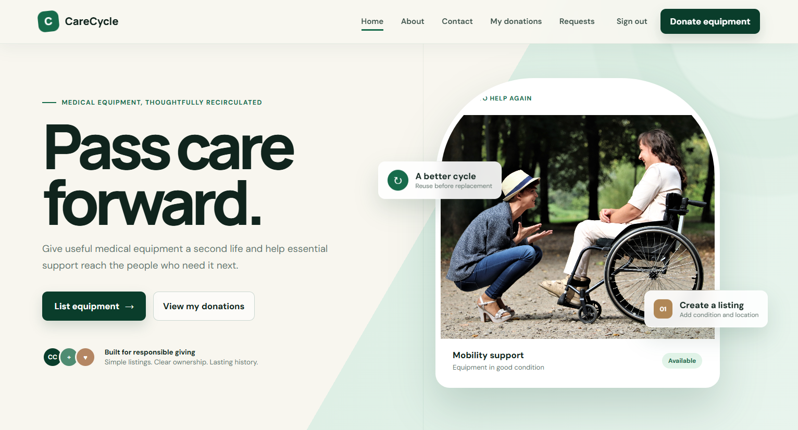
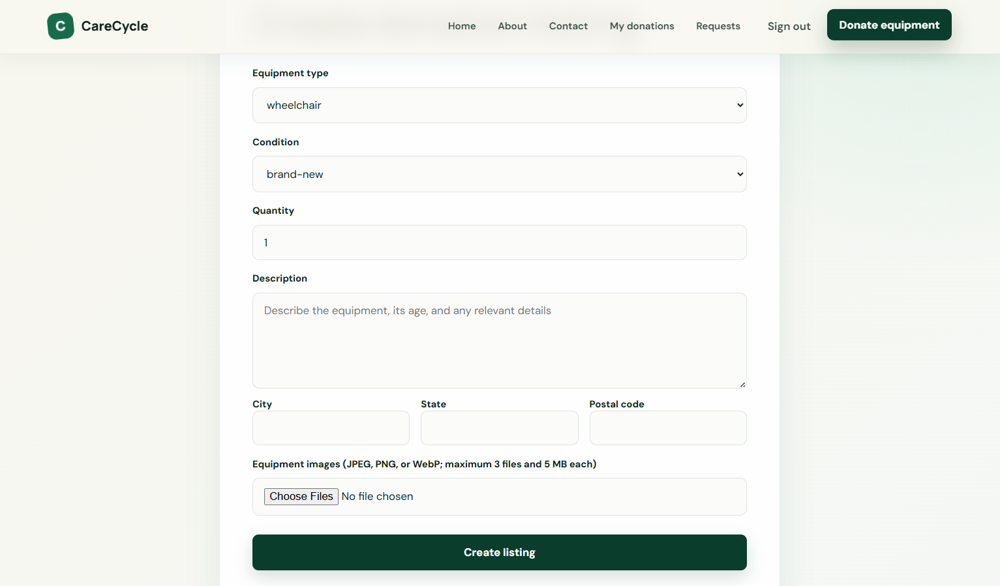
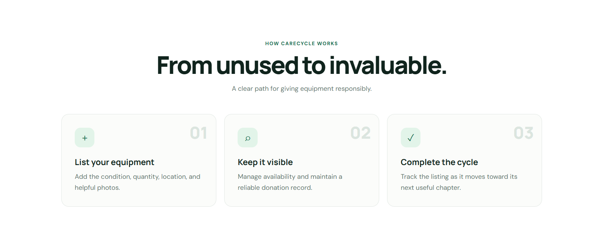
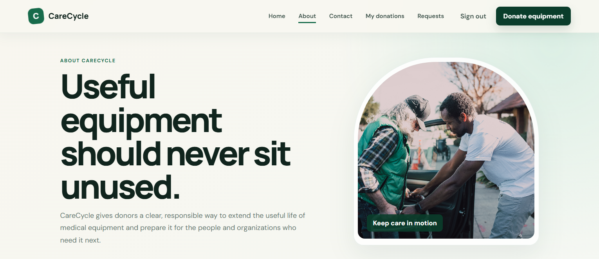
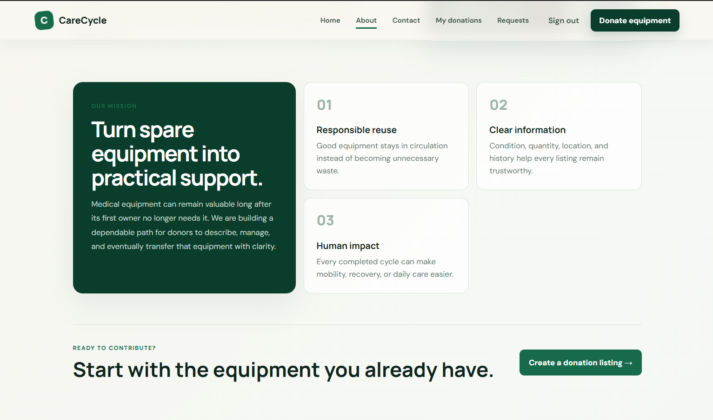

# CareCycle

CareCycle is a full-stack medical-equipment donation platform that connects individual donors with verified NGOs. It provides secure role-based accounts, protected equipment listings, NGO verification, donation requests, donor matching, and a separate CareCycle Administration portal.



> This historical showcase predates the Day 2 interface cleanup. It does not depict the current interface. Individual historical screenshots are available in [`docs/screenshots`](docs/screenshots); refreshed release media is planned for Day 28.

## Current release

**Version:** `0.6.0-alpha.2`

Implemented release stages:

- `0.1` — security and stability foundation
- `0.2` — modular backend and database models
- `0.3` — donor listing workflow and protected images
- `0.4A–0.4C` — roles, authorization, NGO onboarding, and verification evidence
- `0.4D–0.4F` — equipment discovery, NGO requests, donor matching, and controlled contact exchange
- `0.5` — responsive and accessible interface
- `0.6A–0.6A.1` — CareCycle Administration, moderation, audit history, and separated login realms

## Participant experiences

### Donors

- Register and sign in through the participant portal
- Create medical-equipment listings with condition, quantity, location, description, and up to three images
- Edit or withdraw available listings
- Review requests from verified NGOs
- Accept or reject pending requests
- Track allocated quantities and matching history
- Exchange contact information only after accepting a request
- Propose, confirm and reschedule private pickup arrangements with an activity history
- Cancel accepted commitments before handover, report missed collections and resolve disagreements
- Record actual equipment handovers with a checklist, resolve NGO receipt discrepancies and agree remaining-unit releases
- Issue private, versioned receipts for completed acknowledged handovers and agree receipt name corrections
- Receive private lifecycle notifications, mark updates read and opt into generic notification emails

### NGO members

- Register through the participant portal
- Submit an organization profile and private verification document
- Correct and resubmit rejected applications
- Browse available equipment after verification
- Filter equipment by type, condition, city, state, or postal code
- Submit bounded equipment requests with beneficiary and need information
- Cancel pending requests and review request history
- Receive donor contact information only after an accepted match
- Arrange pickup with the matched donor using explicit time zones and counterparty confirmation
- Report missed collections, retain private activity history and cancel accepted requests before handover
- Acknowledge physical receipt or report quantity/condition discrepancies before a request completes
- Download/print recorded receipts and add optional aggregate equipment-use notes without identifying beneficiaries
- Receive verification and donation updates in a private inbox, with optional notification email

### CareCycle Administration

- Use a separate authentication realm at `/admin/login`
- Review private NGO verification evidence
- Approve or reject NGO applications
- Suspend or reactivate donor and NGO accounts
- Review operational metrics and administrative audit records
- Review issued donation receipts and archived revisions through read-only administration access
- Review administration-access requests before securely provisioning accounts

CareCycle Administration is an internal platform role. It is not a government or ministry portal, and administrator accounts cannot be created through public registration.

## Technology

- Node.js and Express
- MongoDB and Mongoose
- EJS and CSS
- JWT authentication
- Bcrypt password hashing
- Express sessions and CSRF protection
- Multer uploads with MIME and file-signature validation
- Nodemailer-ready notification service
- Node.js built-in test runner

## Product foundation and architecture

- [Product scope and current role permissions](docs/product-foundation.md)
- [Current architecture, routes, models, and planned changes](docs/architecture.md)
- [Day 1 baseline checks and known limitations](docs/day-1-baseline.md)
- [Day 2 research questions and provisional design decisions](docs/user-needs-and-design.md)
- [Day 2 screen sketches](docs/day-2-screen-sketches.md) and [promotional asset inventory](docs/promotional-assets.md)
- [Day 2 implementation checks and browser evidence](docs/day-2-verification.md)
- [Day 5 quantity/lifecycle contracts and migration procedure](docs/quantity-and-lifecycle-contracts.md)
- [Day 5 implementation and verification](docs/day-5-verification.md)
- [Day 6 transactional matching and verification](docs/day-6-verification.md)
- [Day 7 request policies and required index migration](docs/day-7-request-policies.md)
- [Day 7 implementation and verification](docs/day-7-verification.md)
- [Database workflow regression coverage and isolation](docs/database-regression-suite.md)
- [Day 8 implementation and verification](docs/day-8-verification.md)
- [Day 9 pickup arrangements and verification](docs/day-9-verification.md)
- [Day 10 cancellation and missed-pickup policies and verification](docs/day-10-verification.md)
- [Day 11 handover, acknowledgement and partial-fulfillment verification](docs/day-11-verification.md)
- [Day 12 receipt revisions, outcome policies and verification](docs/day-12-verification.md)

The portfolio release targets one reliable equipment journey from listing through NGO-acknowledged handover and a traceable receipt. Pickup, cancellation, missed reports, physical handover, NGO acknowledgement, discrepancy resolution, agreed remaining-unit release, versioned printable/downloadable HTML receipts and optional aggregate outcome notes are implemented. Browser printing supports Save as PDF. Durable lifecycle notifications remain Day 13. Government portals, payments, full hospital inventory, and multi-member organizations are outside this release's scope.

## Security controls

- Separate participant and CareCycle Administration login realms
- Server-enforced donor, NGO, and administrator roles
- Resource-ownership middleware
- Verified-organization middleware
- HTTP-only authentication cookies
- Session-bound CSRF tokens
- MongoDB-backed sessions and shared limits, secure production cookies and an enforced browser policy. See [persistent security](docs/persistent-security.md).
- Authentication and action rate limiting
- Suspended-account enforcement
- Single-use email verification and password recovery with authentication revocation. See [account recovery and delivery limits](docs/account-recovery.md).
- Private verification documents and donation images
- File size, count, MIME-type, and binary-signature validation
- Transactional request acceptance and quantity reservation to prevent over-allocation
- Administrative audit records
- Accountable organization, account and listing review with private commitment exceptions. See [administrative moderation](docs/admin-review.md).
- No public administrator registration

## Project structure

```text
CareCycle-main/
├── index.js
├── src/
│   ├── config/
│   ├── controllers/
│   ├── middleware/
│   ├── models/
│   ├── routes/
│   ├── services/
│   └── validators/
├── views/
│   └── partials/
├── public/
├── scripts/
├── tests/
├── docs/screenshots/
└── uploads/                 # Runtime files; ignored by Git
```

## Run locally with PowerShell

Requirements:

- Node.js 22.x (22.14.0 or later) and npm 10.x
- MongoDB Community Server or a reachable MongoDB deployment
- MongoDB Compass is optional

```powershell
# Run from the repository root.
npm ci
```

Create a `.env` file:

```env
NODE_ENV=development
PORT=4000
MONGO_URI=mongodb://127.0.0.1:27017
MONGO_DB_NAME=CareCycle
JWT_SECRET=replace-with-a-long-random-secret
SESSION_SECRET=replace-with-another-different-random-secret
APP_URL=http://localhost:4000
```

Replace both example secrets with independent random values using the [runtime configuration instructions](docs/runtime-configuration.md), then run `npm run config:check`. The check does not start the application or connect to MongoDB.

Start MongoDB and CareCycle:

```powershell
Start-Service MongoDB
npm start
```

Open [http://localhost:4000](http://localhost:4000).

## Provision a CareCycle administrator

Administrator accounts are provisioned deliberately rather than publicly registered:

```powershell
$env:ADMIN_NAME="CareCycle Administrator"
$env:ADMIN_EMAIL="admin@example.com"
$env:ADMIN_PASSWORD="Choose-A-Strong-Password-2026"
npm run seed:admin
$env:ADMIN_NAME=$null
$env:ADMIN_EMAIL=$null
$env:ADMIN_PASSWORD=$null
```

Then sign in at [http://localhost:4000/admin/login](http://localhost:4000/admin/login).

## Testing

```powershell
npm test
```

The test suite covers input validation, role separation, ownership, verified-organization access, matching capacity, model contracts, and EJS rendering.

No developer `.env` or running MongoDB service is needed for `npm test`. See [reproducible verification](docs/testing.md) for supported versions, isolated database/browser smoke commands, CI and failure artifacts, and [Day 3 verification evidence](docs/day-3-verification.md) for what has actually passed.

Runtime settings are now validated before startup. See [configuration and local replica-set setup](docs/runtime-configuration.md) and run `npm run config:check` to validate without starting the app. Generate independent secrets instead of keeping example placeholders. Existing explicit database names are preserved; `.env.example` uses `CareCycle` for new setups. Production settings must be injected explicitly, including HTTPS, secure database access and actual trusted proxy addresses.

New private uploads use MongoDB GridFS rather than the application filesystem. Existing local uploads remain readable until migrated. See [durable private uploads](docs/private-uploads.md) for the manifest dry run, integrity-checked migration, orphan cleanup, and database backup requirements.

## Screenshot gallery

| Participant login | Home | Donation form |
|---|---|---|
|  |  |  |

| How it works | About CareCycle | Mission |
|---|---|---|
|  |  |  |

## Planned work

See the [daily development roadmap](docs/development-roadmap.md) for 28 ordered development stages, acceptance checks, and suggested commits. It builds on the current prototype, prioritizing matching correctness, a complete pickup and handover journey, usable interfaces, and a verified portfolio demo. Stages are planned work, not completed features or fixed calendar deadlines.

- Release `0.6B`: notifications and NGO acknowledgement
- Release `0.7`: pickup, handover, expenses, inventory, and outcome reporting
- Release `0.8`: multi-member NGO accounts and granular organization permissions
- Release `0.9`: operational analytics and report exports
- Release `1.0`: managed infrastructure, deployment, monitoring, backups, and production security
- Post-`1.0`: separate government or departmental oversight portal

## Important note

CareCycle is currently a functional development prototype. Production use involving real organizations, contact information, beneficiary data, or medical equipment requires a privacy review, legal and regulatory assessment, operational safety procedures, managed infrastructure, and independent security testing.
