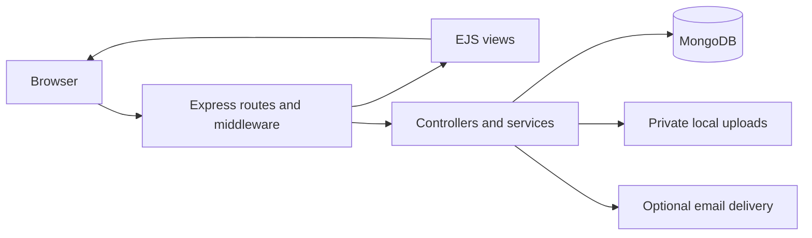

# CareCycle

CareCycle is a medical equipment donation prototype that connects donors with verified non-governmental organizations (NGOs). Donors list equipment, approved NGOs request quantities, and donors review requests before coordinating collection.

## Overview

Useful equipment can remain unused while organizations struggle to find suitable donations. CareCycle brings listings, organization verification, request decisions, and donation history into one role-based application.

The project is an alpha prototype. Organization verification does not certify equipment condition or medical suitability.

## Demo and preview

[Open the hosted CareCycle demo](https://carecycle-demo.onrender.com/demo)

The hosted demo uses fictional donor and NGO accounts and equipment. Registration, uploads, administrative access, and outbound email are disabled. Do not enter real donation or personal information. The hosted demo runs a later development version; its additional workflows are not all included in this branch.


The screenshot shows the homepage in a donor session; navigation varies by role.

## Features

### Donors

- Create listings with equipment category, condition, quantity, description, location, and optional images.
- Edit or withdraw available listings.
- Review NGO requests and accept or reject them.
- Track listings, allocated quantities, and request history.
- Access organization contact details after accepting a request.

### NGO members

- Submit an organization profile and verification document for administrative review.
- Browse available equipment after organization approval.
- Filter listings by category, condition, and location, with paginated results.
- Request quantities with a need statement and track request decisions.
- Cancel pending requests and access donor contact details after acceptance.

### Administration

- Review organization evidence and approve or reject applications.
- Review recent administrative activity and account statistics.
- Suspend or reactivate participant accounts with recorded review reasons.
- Review administrative access requests; public registration grants only donor or NGO roles.

## Technology stack

| Purpose | Technologies |
| --- | --- |
| Application | JavaScript ES modules, Node.js, Express 4 |
| Interface | EJS, HTML, CSS, browser JavaScript |
| Database | MongoDB, Mongoose |
| Authentication and forms | bcrypt, JSON Web Tokens, express-session, cookie-parser |
| File uploads | Multer and private local upload directories |
| Optional email | Nodemailer |
| Development and checks | npm lockfile, nodemon, Node.js test runner |

## Architecture and workflow



`index.js` starts the application after connecting to MongoDB. Routes apply authentication, role checks, and ownership checks before controllers read or update models and render views. Uploads are served through controlled routes rather than public static directories.

1. A donor creates an equipment listing.
2. An NGO submits its organization profile for administrative approval.
3. The approved NGO browses equipment and requests a quantity.
4. The donor accepts or rejects the request. Acceptance reserves capacity and enables contact sharing.
5. Both parties coordinate collection using the shared contact information.

Implemented safeguards include password hashing, role and ownership checks, CSRF validation, rate limiting, and upload type/size checks. These mechanisms do not constitute a security audit or a production-readiness guarantee.

## Project structure

```text
index.js                 Application entry point
src/
  app.js                 Express application assembly
  server.js              Database connection and server startup
  config/                Runtime settings and database configuration
  routes/                HTTP routes and access checks
  controllers/           Request handling and view rendering
  services/              Matching, authentication, uploads, and email
  models/                MongoDB schemas
  middleware/            Access control and request safeguards
  validators/            Input validation
views/                   EJS pages and shared partials
public/                  Styles, browser scripts, and public images
scripts/                 Source checks and administrative utilities
tests/                  Unit and template tests
```

## Local setup

### Prerequisites

- Node.js and npm. Node.js 22 is a suitable baseline; this branch does not declare an engine version constraint.
- A dedicated MongoDB development database.
- Writable private local storage for uploaded images and organization documents.
- A mail service if contact messages and donation email alerts are needed.

### Installation and startup

```sh
git clone https://github.com/kunalpehere/CareCycle.git
cd CareCycle
npm ci
```

Configure the required services locally and keep private configuration outside version control. Database connectivity and authentication/session configuration are required. Optional mail delivery requires the corresponding service configuration. Runtime configuration behavior is defined in `src/config/env.js`; no credential examples are included here.

Use a fresh development database to try the application. Mongoose creates indexes in development. An existing database containing older embedded donation records may require the migration utility to be reviewed separately. Do not run migrations against shared data merely to try the application.

```sh
npm run dev
```

Open `http://localhost:4000` when using the default port. Development uses nodemon to restart on file changes. Use `npm start` to run without file watching.

Register separate donor and NGO accounts. Submit the NGO profile and have an authorized administrator approve it before browsing equipment. Administrator access is provisioned separately through the administrative tooling. Create a donor listing, submit an NGO request, then return to the donor workspace to review it. Use fictional data in development.

## Selected HTTP routes

Most routes render HTML pages or process browser forms rather than exposing a standalone REST API. Protected routes require the corresponding signed-in role and applicable ownership checks.

| Method | Route | Purpose and access |
| --- | --- | --- |
| GET | `/` | Public homepage |
| GET | `/login` | Participant sign-in |
| GET | `/donor/dashboard` | Donor workspace |
| GET | `/donate` | Donor listing form |
| GET | `/donor/requests` | Requests for the donor's listings |
| GET | `/ngo/organization` | NGO profile submission page |
| GET | `/ngo/equipment` | Equipment discovery for an approved NGO |
| GET | `/ngo/requests` | Approved NGO's request history |
| GET | `/admin/dashboard` | Administrator overview |
| GET | `/admin/users` | Administrator account review |

State-changing forms require CSRF validation. Use the interface to submit actions with the required fields and access checks.

## Checks and tests

```sh
npm run check
npm test
```

`check` verifies JavaScript syntax in the application entry point, source, and administrative scripts. `test` runs those checks followed by Node.js tests covering input validation, model contracts, role/ownership rules, and EJS rendering. These tests do not establish live database behavior or browser compatibility.

This branch does not contain a CI workflow or dedicated integration/browser test scripts.

## Limitations and proposed improvements

- Listing categories currently cover wheelchairs, walkers, canes, and stethoscopes.
- Collection coordination relies on contact sharing; this branch does not implement pickup scheduling, handover acknowledgement, or receipts.
- Matching updates listing capacity and requests separately, with compensating capacity release; it does not use a database transaction.
- Sessions use the default in-memory store and rate limits are process-local. Persistent shared stores are needed for robust production operation.
- Private uploads need separately managed durable storage and backups.
- Email delivery depends on a configured external service.
- **Proposed improvements:** transactional matching, persistent session storage, structured collection workflows, and isolated integration/browser tests. These are not completed features in this branch.

## Contributing and licensing

Keep changes focused, use fictional test data, and run the available checks before opening a pull request. Never commit private configuration or participant uploads.

`package.json` declares ISC, but the repository does not contain a standalone license file. Confirm licensing terms before reuse or redistribution.
