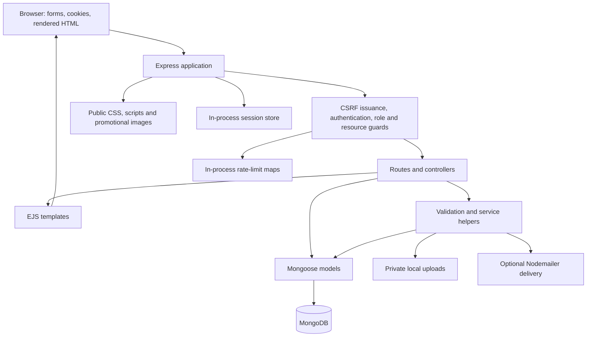
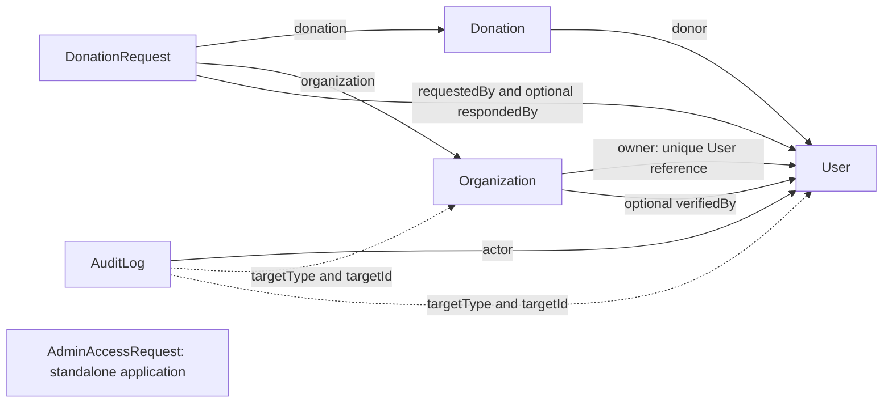
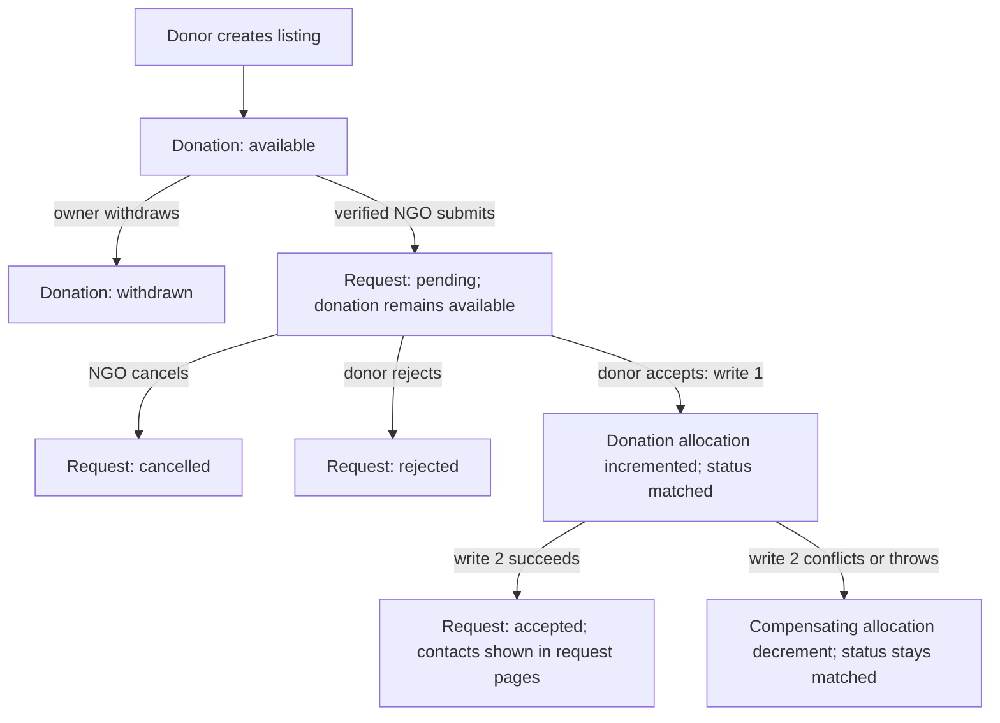

# CareCycle architecture

Current implementation reviewed October 11, 2026, version `0.6.0-alpha.2`. Diagrams describe source behavior, not a verified deployment. See [product scope and permissions](product-foundation.md), [verification evidence](day-1-baseline.md), and the [roadmap](development-roadmap.md).

## Runtime and request path

[`index.js`](../index.js) starts [`src/server.js`](../src/server.js), which connects MongoDB before listening. [`src/app.js`](../src/app.js) configures Express, EJS, public static files, size-limited body parsing, cookies, sessions, CSRF token issuance, routes, and error handlers. Run from the repository root because views, static assets, and upload directories are resolved from the working directory. No frontend build is currently defined.

Controllers assemble model queries and render EJS or redirect forms; `/donateinfo` returns the current donor's listing JSON. Validators live in [`src/validators/input.js`](../src/validators/input.js). Services handle tokens, roles, mail, media, and matching. There is no background notification worker or durable outbox today.

## Authentication and request boundaries

- Public registration creates donor or NGO accounts. Participant and administrator login endpoints restrict the allowed roles, using [`loginRealmService.js`](../src/services/loginRealmService.js). Both sign-in flows issue the same authentication cookie mechanism; they are separate entry points, not independent simultaneous sessions.
- Passwords are bcrypt hashes. JWT authentication uses the `token` cookie and loads the user from MongoDB on authenticated requests. Active users and legacy users with no status field are accepted; suspended/deleted users are refused. See [`authenticate.js`](../src/middleware/authenticate.js).
- Express sessions hold CSRF state separately from JWT authentication. Login regenerates the session; logout clears the authentication cookie and destroys the session. Forms require session-bound CSRF verification, including after multipart parsing for uploads.
- Role guards, ownership middleware, verified-organization middleware, and controller predicates determine access. Declared strings in [`authorizationService.js`](../src/services/authorizationService.js), including `donation:moderate`, do not create endpoints or bypass those guards.
- Session state uses Express's default memory store; rate limits use local `Map` instances. Restart or multiple instances do not preserve/share those stores. Existing browser security headers do not establish the later deployment/CSP requirements.

## Current route inventory

All paths below are mounted at the application root. Authenticated paths also enforce account availability. Mutating business routes have action limiting and CSRF checks; authentication submissions have authentication limiting and CSRF checks. `POST /logout` requires CSRF but has no authentication guard.

| Source | Routes | Main boundary |
|---|---|---|
| [`authRoutes.js`](../src/routes/authRoutes.js) | GET/POST `/register`, `/login`, `/admin/login`, `/admin/access-request`; POST `/logout` | GET forms are guest-only; controllers restrict registration/login roles. Access request records an application, not an admin account. |
| [`pageRoutes.js`](../src/routes/pageRoutes.js) | GET `/`, `/home`, `/about`, `/contact` | Authentication, all roles; these are not guest public pages yet. |
| [`contactRoutes.js`](../src/routes/contactRoutes.js) | POST `/contact` | Authentication, all roles. |
| [`dashboardRoutes.js`](../src/routes/dashboardRoutes.js) | GET `/dashboard`, `/ngo/dashboard`, `/admin/dashboard` | Role redirect; NGO-only and admin-only dashboards. |
| [`donationRoutes.js`](../src/routes/donationRoutes.js) | GET `/donor/dashboard`, `/donate`, `/donateinfo`, `/donations/images/:filename`; GET/POST `/donations/:id/edit`; POST `/donate`, `/donations/:id/withdraw` | Donor only; ownership for edit/withdraw and image lookup; edit/withdraw only `available`. |
| [`organizationRoutes.js`](../src/routes/organizationRoutes.js) | GET/POST `/ngo/organization`, `/ngo/organizations/:organizationId/edit` | NGO only; own organization for editing; verified profile updates refused. |
| Same organization router | GET `/organizations/:organizationId/verification-document` | NGO owner or administrator, checked in controller. |
| Same organization router | GET `/admin/organizations/:organizationId/review`, `/admin/users`; POST `/admin/organizations/:organizationId/:decision`, `/admin/users/:userId/:status` | Admin only; approve/reject pending application; activate/suspend donor or NGO. |
| [`discoveryRoutes.js`](../src/routes/discoveryRoutes.js) | GET `/ngo/equipment`, `/ngo/equipment/:id`, `/ngo/equipment/:id/images/:filename` | Verified NGO; listing must be `available`; images must belong to that listing. |
| [`requestRoutes.js`](../src/routes/requestRoutes.js) | GET `/ngo/requests`; POST `/ngo/equipment/:id/requests`, `/ngo/requests/:requestId/cancel` | Verified NGO; own organization requests; cancellation only while pending. |
| Same request router | GET `/donor/requests`; POST `/donor/requests/:requestId/:decision` | Donor only; request must belong to own listing; accept/reject pending requests. |

Source details: [`donationController.js`](../src/controllers/donationController.js), [`organizationController.js`](../src/controllers/organizationController.js), [`discoveryController.js`](../src/controllers/discoveryController.js), [`requestController.js`](../src/controllers/requestController.js), and [`adminController.js`](../src/controllers/adminController.js).

## Data model

Arrows below represent references, not automatic deletion cascades. Each organization has one unique owner. A user may own no organization, and users of other roles need not own one.

| Model | Stored contract and constraints |
|---|---|
| [`User`](../src/models/User.js) | Unique email, hashed password, donor/NGO/admin role, active/suspended/deleted status. `emailVerifiedAt` exists, but email verification/reset flows are not implemented. |
| [`Organization`](../src/models/Organization.js) | Unique owner; optional unique registration number; contact/address/profile fields; required document metadata; pending/verified/rejected review, reason and review timestamps/actor. |
| [`Donation`](../src/models/Donation.js) | Donor, category, condition, quantity 1 to 100, `allocatedQuantity`, description/location, up to three image metadata entries. Status enum: available/requested/matched/pickup_scheduled/completed/withdrawn. Optional unique legacy migration key. |
| [`DonationRequest`](../src/models/DonationRequest.js) | Donation, organization, requesting user, quantity 1 to 100, beneficiary summary, need message, decision metadata. Status enum: pending/accepted/rejected/cancelled/completed. Unique donation/organization pair across all statuses. |
| [`AuditLog`](../src/models/AuditLog.js) | Actor, action, organization/user target, details, timestamps. Admin mutation and audit insertion are separate writes. |
| [`AdminAccessRequest`](../src/models/AdminAccessRequest.js) | Unique work email, applicant details and justification; pending/reviewed/rejected status. Dashboard lists pending applications; no application-decision route exists. Provisioning uses the admin seed script separately. |

The donor dashboard can also read legacy embedded `User.products` directly from the collection. [`scripts/migrate-embedded-donations.js`](../scripts/migrate-embedded-donations.js) is the existing migration entry point. This Day 1 work runs no migrations or data mutations.

## Current lifecycle and acceptance failure boundary

[`matchingService.js`](../src/services/matchingService.js) conditionally increments allocation if it will not exceed total quantity, then accepts the pending request in a separate write. This capacity predicate is useful but does not make the whole decision transactional. A process failure between writes can leave an orphan reservation. Compensating release does not restore the previous listing status and can itself fail.

For example, accepting two units from a five-unit listing stores two allocated units and sets the listing to `matched`. Discovery/detail/image access and new requests query only `available`, so the remaining three units disappear from discovery. Request creation validates against total quantity, not remaining quantity. A unique donation/organization index prevents another request even after rejection or cancellation.

Withdrawal and editing do not resolve pending requests. A request submitted before withdrawal can remain pending; acceptance cannot reserve a withdrawn listing. Pickup and completion status values are schema vocabulary only: no pickup scheduling, accepted-request cancellation, donor handover, NGO acknowledgement, or receipt routes exist today.

## Files, mail, and privacy

- `public/` is static. Runtime uploads are not statically mounted. Donation images live in `uploads/donations`; verification files live in `uploads/verification-documents`. Services create these relative directories when saving files.
- Upload parsing uses memory buffers, count/size limits, allowed MIME types, and basic signature checks. Donation limits are three JPEG/PNG/WebP images at 5 MiB each; verification uses one PDF/JPEG/PNG at 8 MiB. Signature checking is not malware scanning or medical-content validation.
- Donors retrieve only their images. Verified NGOs can retrieve images on available listings. Organization evidence is accessible only to the NGO owner or an administrator. These controls are described from source and existing tests, not a fresh adversarial database/browser audit.
- Request-page data exposes matched contacts for accepted/completed requests and removes the raw contact-bearing populated objects from other request states. Donor email is nevertheless included in new-listing email to configured recipients by [`mailService.js`](../src/services/mailService.js). Contact messages also go to configured recipients.
- Mail is optional, immediate delivery via Nodemailer. Listing creation survives mail failure and reports its result. There is no durable retry, lifecycle notification inbox, or provider-delivery verification in Day 1.
- Beneficiary summaries, contact information, document contents, upload metadata, and account credentials are sensitive. Documentation and demo evidence must use synthetic data; this review did not read runtime records, uploads, or secret configuration.

## Planned architectural work

These are release intentions, not components shown as implemented above:

| Roadmap stages | Planned change |
|---|---|
| Days 3 to 4 | Reproducible CI/check environments, stronger runtime validation, documented replica-set setup. |
| Days 5 to 8 | Quantity/lifecycle contracts, atomic allocation with MongoDB transactions, explicit retry/index migration policy, real isolated database regression tests. |
| Days 9 to 13 | Per-request collection arrangements, exact-once reservation release, two-party handover, traceable receipts, durable lifecycle events/outbox. |
| Days 14 to 18 | Guest public explanation and usable donor/NGO/admin/mobile experiences with verified design cleanup. |
| Days 19 to 24 | Account recovery, accountable moderation, shared persistent sessions/limits, durable private storage, observability, backup/restore evidence. |
| Days 25 to 28 | Isolated staging demo, complete browser release gate, measurements and honest portfolio evidence. |

Production topology, providers, performance and recovery guarantees remain unverified. Keep the existing stack and choose infrastructure against those later acceptance checks rather than presenting a future architecture as deployed.
